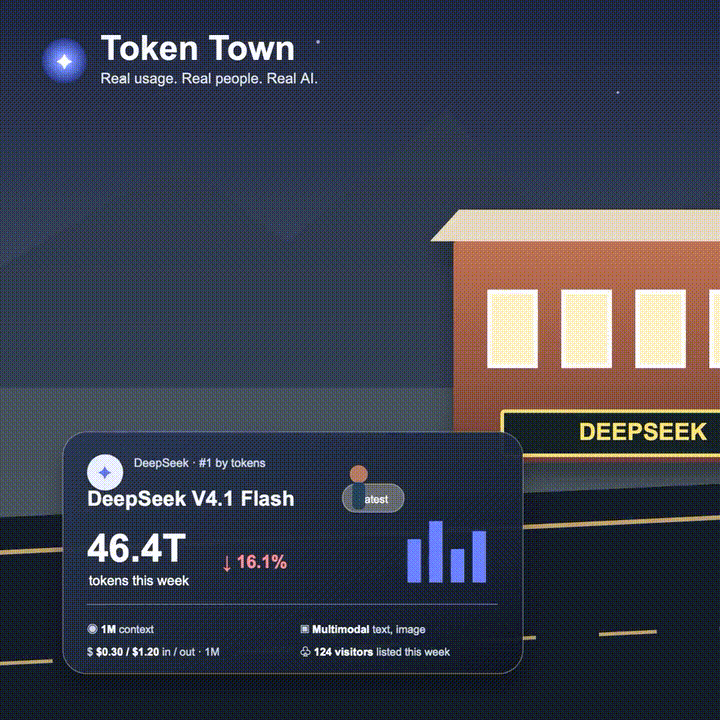

<div align="center">

# ✦ Token Town

### The AI economy, made walkable.

**A cinematic, interactive town where the busiest AI labs own the brightest corners.**

[Launch locally](#-launch-it) · [Take the tour](#-uiux-tour) · [Why this exists](#-why-token-town) · [Share it](#-make-it-travel)



[▶ Watch the town come alive](assets/token-town-ui-tour.mp4)

</div>

---

## What is Token Town?

Token Town turns an invisible metric — AI model usage — into a place you can feel.

Each storefront is an AI lab. Its size, light, energy, and foot traffic stand in for the demand around its models. Move through the town and the featured shop changes: you see the model, token volume, usage trend, context window, modality, price, and the crowd it attracts.

It is not a leaderboard in disguise. It is a new way to make a fast-moving ecosystem legible in a single, shareable glance.

> **The thesis:** when a technology reshapes the economy, its activity should be understandable without opening a spreadsheet.

## Why we built this

AI is often discussed as a race of benchmark scores and launch-day headlines. But the more revealing signal is whether people keep showing up: which models are being used, where momentum is gathering, and how the ecosystem shifts week to week.

Token Town makes that story human:

- **Usage becomes visual.** Token volume becomes an active street, not a column of numbers.
- **Competition becomes intuitive.** A glance reveals scale, momentum, and relative attention.
- **Data becomes worth sharing.** The format is made for screenshots, conversations, and “wait, look at this” moments on LinkedIn and X.
- **Curiosity wins.** Browse the town like you would a neighborhood — no dashboard fluency required.

The result is part data story, part tiny world, and part invitation to ask: *which AI corner will be busy next week?*

## 🎥 UI/UX tour

The looping preview sets the scene: a miniature AI district at blue hour, with warm storefronts and a city stretching into the distance. Open the live app to move through its labs and interact with the town:

| Moment | What it feels like |
| --- | --- |
| **Explore stores** | Previous/Next or arrow keys move between featured AI labs. |
| **Read the room** | Token volume, trend, context, modality, pricing, and visitors sit in one cinematic card. |
| **Change the atmosphere** | Day/night shifts the town from moonlit neon to daylight. |
| **Set the pace** | Pause the street or switch timelapse speed. |
| **Make it travel** | Native sharing or a ready-to-post caption gives every visitor a clean social handoff. |

> Demo values are intentionally illustrative. That keeps the experience instant, offline-friendly, and ready for a live data source when one is selected.

## ✨ Make it travel

Token Town is engineered for the social loop: discover → explore → capture → share → debate.

**Suggested X post**

```text
AI usage shouldn’t live in a spreadsheet.

I built Token Town — a living street where the busiest AI labs get the brightest storefronts.

Which model do you think owns the next block? 🏙️
```

**Suggested LinkedIn post**

```text
The AI economy is hard to see when it is trapped in charts.

Token Town turns model usage into a living, walkable city: each lab has a storefront, each model has a pulse, and the busiest corners tell the story at a glance.

We wanted to make AI adoption feel less like reading a dashboard and more like looking out a window.

What signal would you want to see in the town next?
```

## 🚀 Launch it

No build step. No dependencies. Just a tiny town with a big point of view.

```sh
git clone https://github.com/technomad641/token-town.git
cd token-town
python3 -m http.server 4173 --bind 127.0.0.1
```

Then visit **[http://localhost:4173](http://localhost:4173)**.

## 🕹 Controls

| Control | Action |
| --- | --- |
| `←` / `→` | Browse labs |
| `Space` | Pause / resume town motion |
| `D` | Toggle day and night |
| On-screen controls | Change playback speed and share |

## Project map

```text
token-town/
├── index.html      # Town and interface structure
├── styles.css      # Cinematic scene, responsive layout, animations
├── app.js          # Lab switching, controls, sharing behavior
└── assets/         # City artwork and README preview media
```

<div align="center">

Built for people who want to **see** where AI is going — not just read about it.

✦ **Different AI. A more open world.**

</div>
